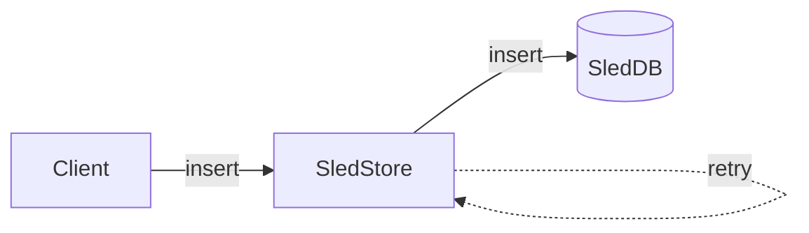
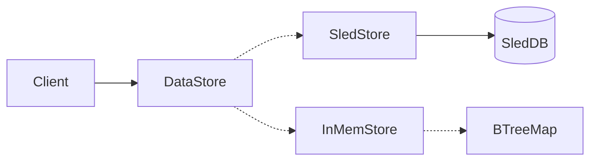
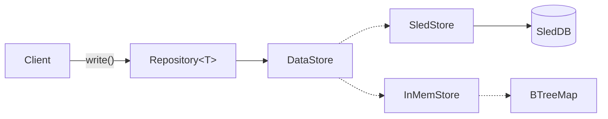

# Persistence Patterns

## Purpose

`e3-data` supplies ciphernode storage mechanisms: scoped key/value access, typed repositories,
snapshot-backed state, append-only event logs, indexes, and large-event blobs. Runtime assembly
belongs to [event-system](../event-system/README.md); domain crates choose repository keys/types.

## Map

| Location                                                                                                             | Responsibility                                                                  |
| -------------------------------------------------------------------------------------------------------------------- | ------------------------------------------------------------------------------- |
| [`data_store.rs`](src/data_store.rs), [`repository.rs`](src/repository.rs), [`repositories.rs`](src/repositories.rs) | Scoped transport wrapper, typed values, and repository factories.               |
| [`persistable.rs`](src/persistable.rs), [`snapshot.rs`](src/snapshot.rs)                                             | In-memory state with scheduled snapshots and explicit hydration traits.         |
| [`sled_store.rs`](src/sled_store.rs), [`sled_db.rs`](src/sled_db.rs), [`in_mem.rs`](src/in_mem.rs)                   | Persistent and memory data actors behind the same operations.                   |
| [`commit_log_event_log.rs`](src/commit_log_event_log.rs), [`event_blob.rs`](src/event_blob.rs)                       | Durable history, bounded reads, validation/repair, and oversized payload files. |
| [`sled_sequence_index.rs`](src/sled_sequence_index.rs), [`in_mem_sequence_index.rs`](src/in_mem_sequence_index.rs)   | Derived timestamp/sequence lookup for each backend.                             |
| [`durable_intent.rs`](src/durable_intent.rs)                                                                         | Explicit record-once intent primitive used by durable effect owners.            |

Events append/sync before delivery; handlers schedule snapshot state through repositories. The
journal remains replay authority while indexes/snapshots accelerate recovery. The sections below
explain why the data-access layers exist and how consumers use them.

For current cross-layer guarantees and limits, see
[persistence and replay](../../docs/architecture/persistence-and-replay.md). Repository keys and
serialized payloads are durable interfaces: a Rust type-compatible change or key rename can still
need an [upgrade decision](../../docs/architecture/upgrades.md).

Acknowledged sync/batch writes flush before success and reject contextual writes older than the
persisted aggregate cursor. Ordinary queued writes are not the same acknowledgment boundary. Use
checked reads where missing data differs from storage/decode failure, especially destructive-command
preflight. No general external-effect outbox is provided here.

_The way persistence is managed within this codebase has a few elements to it. So here is the story
as to how this works and why it has been done like this_

Persistence within an Actor Model tends to be based around the idea that actors need to be able to
have their state persistable and hydratable upon restart. In an ideal scenario, this enables any
actor to be able to just crash on error and restart as required.

We started persistence by creating an Actor that wraps the database which is good practice within an
Actor Model. This has advantages because we can interleave database writes to become a stream of
events enabling high throughput. We can create delivery guarantees by storing events in a persistent
queue at a later point if need be.



## DataStore

Next we needed a way to polymorphically pick between a real database and an in-memory database for
testing - to do this we utilize Actix's `Recipient<Message>` trait which means we can accept any
actor that is happy to receive an `Insert` or a `Get` message. This means we can create a Key Value
Store struct and pass in either a `SledStore` or an `InMemStore` Actor to the `DataStore` actor to
accomplish this.

```rust
// Integration fragment: bus and db_path come from runtime assembly.
let actor = SledStore::new(&bus, &db_path)?;
let store = DataStore::from_sled_store(&actor);
```

or for testing:

```rust
use actix::Actor;
use e3_data::{DataStore, InMemStore};

let actor = InMemStore::new(false).start();
let store = DataStore::from_in_mem(&actor);
```



The `DataStore` wrapper also has convenience methods that scope the keys so that you can consider
the information you are storing as more of a tree structure as opposed to a flat list.

```rust
let store = DataStore::from(&addr);
let scoped = store.scope("//foo/bar/baz");
scoped.write(some_data);
```

## Repository

There was an attempt to use the `DataStore` throughout the app but it became apparent this was
causing the knowledge of where and how the data was saved to be spread throughout the codebase. What
we needed was for the components not to really care how their data was saved but for us to be able
to easily have a sense of the different keys under which data was being saved in a centralized
place.

Also `DataStore` can take any type of serializable data to save at a key location but this means the
data in the DataStore was effectively untyped.

To solve this it made sense to create a typed `Repository<T>` interface to encapsulate saving of
data from within an actor or routine and in theory the repository could use whatever underlying
mechanism requires to save the data. This could even be a SQL DB or the filesystem if required.
Whatever its type `T`, the repository knows how to save it.

The tradeoff is we get a slightly deeper stack but each layer adds a responsibility to the data
saving stack:



| Layer               | Functionality                                                                                                                   |
| ------------------- | ------------------------------------------------------------------------------------------------------------------------------- |
| `Repository<T>`     | Strongly typed Data persistence for a single item. Configured to know how to save its data.                                     |
| `DataStore`         | Flexible KV store. Client can scope to specific namespace. Can be backed by polymorphic data actor to handle testing scenarios. |
| `{InMem,Sled}Store` | Actor to receive `Insert` and `Get` requests can only save raw bytes.                                                           |

## Snapshotting

We had a way to save bytes data with the `DataStore` and had a way to specify where that could be
saved but actors need to be restartable and be able to be hydrated and we needed a standard way to
accomplish this. To do this in typical Rust fashion we created a set of traits:

- [`Snapshot`](https://github.com/theinterfold/interfold/blob/main/crates/data/src/snapshot.rs) for
  defining how an object can create a snapshot of its state
- [`Checkpoint`](https://github.com/theinterfold/interfold/blob/main/crates/data/src/snapshot.rs)
  for defining how to save that snapshot to a repository
- [`FromSnapshot`](https://github.com/theinterfold/interfold/blob/main/crates/data/src/snapshot.rs)
  and
  [`FromSnapshotWithParams`](https://github.com/theinterfold/interfold/blob/main/crates/data/src/snapshot.rs)
  for defining how an object could be reconstituted from a snapshot

This worked well, especially for objects whose persistable state must be derived from a subset of
the saved state however there are a couple of problems:

- `self.checkpoint()` must be called every time you want to save the state
- Using these traits is very verbose and repetitive, especially when the state is just a field on
  the actor which it often is.
- These traits mean you need to mix some persistence API within your business logic API unless you
  create a separate struct just for persistence.

## Enter Persistable

Persistable connects a repository and in-memory state. A successful `try_mutate` admits a snapshot
write before exposing the new memory value, but does not wait for its batch to flush. It schedules
persistence; it does not itself prove the mutation is durable before a subsequent external effect.

This has several benefits:

- Less verbose
- Centralized batching point for logical operations
- Can remove complex "snapshot" traits
- Simpler initialization
- No need to consider the underlying data saving mechanism - logic can be
  [persistence ignorant](https://www.linkedin.com/pulse/persistence-ignorance-domain-driven-design-ilkay-polat-atmae).

```rust

// Fragment inside a handler/routine with a DataStore and sequenced event context.
use e3_data::{AutoPersist, Persistable, Repository};
let repo: Repository<Vec<String>> = Repository::new(store.scope("example/names"));

// Load a persistable object from the repository.
let mut persistable: Persistable<Vec<String>> = repo.load().await?;
if !persistable.has() {
    persistable.set(Vec::new());
}

// A mutation schedules persistence; it is not a durability acknowledgment.
persistable.try_mutate(&context, |mut list| {
  list.push("Fred");
  Ok(list)
})?;

// We can set new state
persistable.set(vec![String::from("Hello")]);

// We can try and get the data if it is set on the object
if persistable.try_get()?.len() > 0 {
    println!("Repo has names!")
}

// Clear the object and its repository.
persistable.clear();

assert_eq!(persistable.get(), None);
```

To use it we can just have it as a field on a struct or actor:

```rust
struct MyActor {
  state: Persistable<Vec<String>>
}
```

We have also extracted the key calculation mechanism to a
[`StoreKeys`](https://github.com/theinterfold/interfold/blob/main/crates/events/src/store_keys.rs)
struct. This is used in various places when creating repository factories, for example
[here](https://github.com/theinterfold/interfold/blob/main/crates/aggregator/src/repo.rs)

## Durable Event Logs and Large Events

The append-only event log is the durable source of truth for actor replay. The Sled repositories
hold indexes and snapshots, but they do not replace committed event history. Startup reconciles the
timestamp index from the log and fails closed when an indexed record is corrupt.

A commit-log frame is limited to 32 MiB. Events that do not fit inline are stored as
content-addressed files in `event-blobs-v1` beside the event log. The log stores a versioned
reference with the blob's SHA-256 digest and length. A single blob is limited to 512 MiB. Opening,
replaying, or repairing the log verifies each referenced blob before decoding it.

Startup removes only blob files that no committed record references. It does not remove referenced
proof work after an E3 completes. Back up the event log and `event-blobs-v1` together, and monitor
their combined growth.

The CLI command `interfold node validate` checks stopped-node state without changing it. Add
`--repair` only for a reported uncommitted physical tail. Repair can restore complete unindexed
frames or truncate a torn suffix. It cannot remove an indexed record or migrate an unsupported
schema.

## Tests

Run `cargo test --locked -p e3-data` from the root. Inline log/blob cases use temporary physical
files to cover reopen, byte-bounded reads, integrity, and uncommitted tails. Sled tests cover
batch/cursor behavior; memory tests cover backend operations; `persistable.rs` tests distinguish
rejected write admission from a changed in-memory value. Runtime snapshot ordering/shutdown is
tested in [event-system](../event-system/README.md). See [AGENTS.md](AGENTS.md) for durable-format
and repair change constraints.
