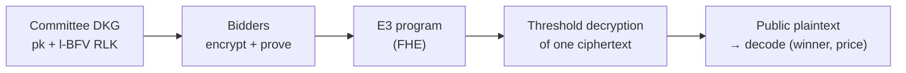

# Sealed-bid auctions on Interfold with l-BFV: options, parameters, performance

Status: research report for review. Measured values have a source. Estimates are marked
**[estimate]**. The open questions for review are in [section 13](#13-questions-for-review).

## 1. Summary

- **Goal.** A sealed-bid auction where the public learns the winner and the price, and nothing more.
  No party sees a bid. Bidders encrypt under the committee key. An E3 program evaluates the auction
  homomorphically with the l-BFV threshold relinearization key. The committee threshold-decrypts one
  ciphertext.
- **Recommended design: `vickrey`** (second price), when `n · B ≤ N`. Each bidder sends 3 SIMD
  ciphertexts. The program uses 4 ct×ct products at depth 3, for any number of bidders. The output
  is a pattern of zero slots that is a function of (winner, price) only, if at least one bidder mask
  is honest.
- **For a larger price range: the ratio-lane designs `rl-first-price` and `rl-second-price`
  ([section 6](#6-the-ratio-lane-designs)).** The range does not depend on the number of bidders (up
  to 16 bidders at `N = 16384`: `B = 16383` for the first price at depth 1, and `B = 8191` for the
  second price at depth 3; `vickrey` has `N/n`, 1024 at `n = 16`). The cost: a tie is not resolved
  in the program. The output shows the tie set, and a random lane in the output picks the winner
  ([section 7](#7-ties)). They need the same output publication as `vickrey`. They are in the design
  study and in the end-to-end demo as auction types 2 and 3.
- **It works end to end today on insecure parameters** (`N = 128`, `t = 257`): real 3-node DKG,
  proven bids, FHE program, threshold decryption, web application.
- **A secure version needs 2 platform changes:**
  1. A new SIMD preset. The proposed set is `N = 16384`, `t = 65537`, 5 × 57-bit moduli (log q =
     281). The parameter search gives this set for depth 3, `n = 20` ciphernodes, `λ = 31`. No
     current secure preset has SIMD slots.
  2. A way to publish the whole decrypted ring (16384 coefficients). Today the committee publishes
     at most 50 coefficients (128 for the insecure SIMD preset). The `vickrey` output needs all
     slots, and every slot depends on every coefficient.
- **Fallback that fits the 50-coefficient cap:** `first-price` and `second-price` put the result in
  coefficient 0. Their depth grows with `⌈log2 n⌉`, so at depth 3 they support at most 8 and 4
  bidders.

## 2. Setting and trust model



- The committee decrypts **one** ciphertext and publishes its plaintext. Thus the plaintext must be
  a function of the intended result and of random values only.
- Assumptions:
  - The committee is honest in the threshold sense (fewer than `T + 1` members collude).
  - At least one bidder mask is honest (uniform and unknown to the others).
  - Input proofs show that each bid ciphertext is well formed.
  - The l-BFV relinearization key inherits the circular-security assumption of the multi-key
    construction it adapts (CDKS19, via Urban–Rambaud,
    [ePrint 2024/1285](https://eprint.iacr.org/2024/1285)).
- Arithmetic is in the plaintext ring `Z_t[X]/(X^N + 1)`. With `t` prime and `t ≡ 1 (mod 2N)`, the
  ring splits into `N` SIMD slots. Addition and multiplication then act slot by slot.

## 3. Encoding

A bid `b` is a level in `0..B-1`. The bidder encodes it as two **thermometers** over the levels `p`:

```text
ge[p] = [b ≥ p]        gt[p] = [b > p]        ge − gt = one-hot [b = p]
```

Thermometers make the sum over bidders useful directly. `c'[p] = Σ_j ge_j[p]` is the number of bids
at or above `p`. A one-hot encoding gives only the number of bids equal to `p`. A running sum across
slots needs rotations (Galois keys), which the DKG does not make (see
[section 12](#12-galois-rotation-keys)).

Example: bids 300, 500, 700, levels of 100:

```text
level p:   0 1 2 3 4 5 6 7 8 9
Alice 300: 1 1 1 1 0 0 0 0 0 0
Bob   500: 1 1 1 1 1 1 0 0 0 0
Carol 700: 1 1 1 1 1 1 1 1 0 0
c'       : 3 3 3 3 2 2 1 1 0 0   → last level with c' ≥ 2 is 5: price 500, Carol wins
```

The slots hold one region of `B` slots for each bidder. Region `k` belongs to the bidder with tie
priority `k`. Spare slots hold copies of the regions. A bidder repeats the thermometer into every
region, so a ciphertext does not depend on the index of the bidder. The program selects each
bidder's own region with plaintext selectors.

## 4. Design comparison

All designs are implemented and tested in `examples/auction` (Rust, fhe.rs, one-party keys; 10
designs). A plaintext simulation of the same designs is in `examples/auction/ts`. `W` is the number
of bidders in one weight group (16 at `t = 65537`, see [section 6](#6-the-ratio-lane-designs)).

| Design               | Public result                             | Other disclosure                  | Ct / bidder | Depth          | ct×ct      | Slots / coefficients used               | Decrypted coefficients needed                                      |
| -------------------- | ----------------------------------------- | --------------------------------- | ----------- | -------------- | ---------- | --------------------------------------- | ------------------------------------------------------------------ |
| `rank`               | Winner                                    | Each bidder can read its own rank | 4           | 2              | `2n`       | `3·n·B` coefficients                    | up to `3·n·B`                                                      |
| `rank-batched`       | Winner                                    | A top tie; own rank               | 4           | 2              | 2          | `3·n²·B` coefficients                   | up to `3·n²·B`                                                     |
| `first-price`        | Winner, winning bid                       | None                              | 1           | `⌈log2 n⌉`     | `n − 1`    | `n·B` slots                             | 1 (coefficient 0)                                                  |
| `first-price-blind`  | Winner, winning bid                       | None if 1 mask is honest          | 2           | 1              | 1          | `n·B` slots                             | all `N`                                                            |
| `second-price`       | Winner, second-highest bid                | None if 1 mask is honest          | 3           | `⌈log2 n⌉ + 1` | `5(n − 1)` | `(n+1)·B` slots                         | 1 (coefficient 0)                                                  |
| `second-price-blind` | Winner, second-highest bid                | The winning bid                   | 2           | 2              | 2          | `(n+1)·B` slots                         | all `N`                                                            |
| **`vickrey`**        | Winner, second-highest bid                | None if 1 mask is honest          | 3           | 3              | 4          | `n·B` slots                             | all `N`                                                            |
| `vickrey-compact`    | Winner, second-highest bid                | None if 1 mask is honest          | 2           | 4              | `n + 4`    | `n·B` slots                             | all `N`                                                            |
| `rl-first-price`     | Winning bid, tie set (random pick)        | The tie set; the random value     | 3           | 1              | 1          | `⌈n/W⌉·B + 1` slots                     | all `N`; `⌈n/W⌉·B + 2` with the prefix decode **[estimate]**       |
| `rl-second-price`    | Second-highest bid, tie set (random pick) | The tie set; the random value     | 4           | 3              | 6          | `(1 + ⌈n/W⌉)·B + 1` slots for each copy | all `N`; `(1 + ⌈n/W⌉)·B + 2` with the prefix decode **[estimate]** |

- Coefficient 0 of a plaintext is `N⁻¹ · Σ slots`. `first-price` and `second-price` use this: the
  result is a sum over slots. Their masks have a zero constant coefficient. Thus 1 decrypted
  coefficient is enough, and they fit the current 50-coefficient cap.
- The blind designs publish a **zero pattern**. A zero test that returns 0/1 needs `x^(t−1)` (depth
  `log2 t`, 16 at `t = 65537`). Thus a blind design cannot fold its result into coefficient 0 at an
  acceptable depth. It needs the full ring.
- `rank` designs need no price computation, but the winner must open a bid commitment outside the
  program, and each bidder learns its own rank.
- The `rl-` designs publish the price as the last non-zero level of a lane, and the winner set as a
  value at that level. They need as many lanes as `⌈n/W⌉`, not `n`. A tie is not resolved in the
  program: the output shows the tie set, and a random lane picks the winner (sections
  [6](#6-the-ratio-lane-designs) and [7](#7-ties)).

### 4.1 Measured program cost at N = 16384, t = 65537, B = 16 (one party)

Source:
`cargo run --release --bin auction-designs -- --params demo --levels 16 --sweep 4,16,64 --seed 7`
(fhe.rs, Apple Silicon laptop; every run `OK` against the plaintext rule). "Moduli" is the crate's
estimate of the count that the depth needs (`221.6 + 49.3·(depth − 2)` bits in primes of about 58
bits); section 9.2 has the exact search.

| Bidders | Design            | Depth | Moduli | ct×ct | ct×pt | Upload / bidder | Program time                                   |
| ------- | ----------------- | ----- | ------ | ----- | ----- | --------------- | ---------------------------------------------- |
| 4       | `first-price`     | 2     | 5      | 3     | 0     | 0.94 MB         | 72 ms                                          |
| 4       | `second-price`    | 3     | 5      | 15    | 4     | 3.44 MB         | 369 ms                                         |
| 4       | `vickrey`         | 3     | 5      | 4     | 12    | 3.44 MB         | 107 ms                                         |
| 4       | `vickrey-compact` | 4     | 6      | 8     | 16    | 2.70 MB         | 253 ms                                         |
| 4       | `rl-first-price`  | 1     | 5      | 1     | 4     | 2.83 MB         | 28 ms                                          |
| 4       | `rl-second-price` | 3     | 5      | 6     | 8     | 4.59 MB         | 159 ms                                         |
| 16      | `first-price`     | 4     | 6      | 15    | 0     | 1.35 MB         | 499 ms                                         |
| 16      | `second-price`    | 5     | 7      | 75    | 16    | 4.64 MB         | 3.02 s                                         |
| 16      | `vickrey`         | 3     | 5      | 4     | 48    | 3.44 MB         | 134 ms                                         |
| 16      | `vickrey-compact` | 4     | 6      | 20    | 64    | 2.70 MB         | 622 ms                                         |
| 16      | `rl-first-price`  | 1     | 5      | 1     | 16    | 2.83 MB         | 39 ms                                          |
| 16      | `rl-second-price` | 3     | 5      | 6     | 32    | 4.59 MB         | 180 ms                                         |
| 64      | `first-price`     | 6     | 8      | 63    | 0     | 1.77 MB         | 3.13 s                                         |
| 64      | `second-price`    | —     | —      | —     | —     | —               | not run: depth 7 needs log q = 468 > 439 limit |
| 64      | `vickrey`         | 3     | 5      | 4     | 192   | 3.44 MB         | 249 ms                                         |
| 64      | `vickrey-compact` | 4     | 6      | 68    | 256   | 2.70 MB         | 2.12 s                                         |
| 64      | `rl-first-price`  | 1     | 5      | 1     | 64    | 2.83 MB         | 88 ms                                          |
| 64      | `rl-second-price` | 3     | 5      | 6     | 128   | 4.59 MB         | 274 ms                                         |

The `vickrey` program stays at depth 3 and 5 moduli for any `n`. Its cost grows only through the
`3n` ct×pt selector products. At 256 bidders it takes 839 ms (`examples/auction/README.md`). The
`rl-first-price` program stays at depth 1 (1 ct×ct) and `rl-second-price` at depth 3 (6 ct×ct) for
any `n`. Their ct×pt products grow as `n` and `2n` (the weights). The upload is 3 ciphertexts of
0.94 MB at depth 1, and 4 ciphertexts of 1.15 MB at depth 3.

### 4.2 Measured cost at the largest B of each design (N = 16384, t = 65537)

Source: the same command with one `--design` and one `--levels` for each row, `--seed 7`. The
largest `B` is the largest that the setup check accepts: `⌊N/n⌋` for `vickrey`, `⌊(N − 1)/⌈n/16⌉⌋`
for `rl-first-price`, and `⌊(N − 1)/(1 + ⌈n/16⌉)⌋` for `rl-second-price`. Every run is `OK`. Random
bids at these `B` do not tie, so the run does not exercise the tie set (the tests do).

| Bidders | Design            | Max B | Depth | ct×ct | ct×pt | Upload / bidder | Program time | B against `vickrey` |
| ------- | ----------------- | ----- | ----- | ----- | ----- | --------------- | ------------ | ------------------- |
| 4       | `vickrey`         | 4096  | 3     | 4     | 12    | 3.44 MB         | 110 ms       | 1×                  |
| 4       | `rl-first-price`  | 16383 | 1     | 1     | 4     | 2.83 MB         | 32 ms        | 4×                  |
| 4       | `rl-second-price` | 8191  | 3     | 6     | 8     | 4.59 MB         | 159 ms       | 2×                  |
| 16      | `vickrey`         | 1024  | 3     | 4     | 48    | 3.44 MB         | 138 ms       | 1×                  |
| 16      | `rl-first-price`  | 16383 | 1     | 1     | 16    | 2.83 MB         | 43 ms        | 16×                 |
| 16      | `rl-second-price` | 8191  | 3     | 6     | 32    | 4.59 MB         | 182 ms       | 8×                  |
| 64      | `vickrey`         | 256   | 3     | 4     | 192   | 3.44 MB         | 316 ms       | 1×                  |
| 64      | `rl-first-price`  | 4095  | 1     | 1     | 64    | 2.83 MB         | 103 ms       | 16×                 |
| 64      | `rl-second-price` | 3276  | 3     | 6     | 128   | 4.59 MB         | 289 ms       | 12.8×               |

The program time changes little with `B`, because the ciphertext size is fixed: for 4 bidders,
`rl-first-price` takes 28 ms at `B = 16` and 32 ms at `B = 16383`. A larger `B` costs a wider
decoding and publication (all `N` coefficients), not a slower program. One run with 20 bidders in 2
weight groups and a top tie across the group border (bidders 3 and 17) gives the right price and tie
set for both RL designs (`rl-first-price` at `B = 8191`, `rl-second-price` at `B = 5461`, with 133
bits of noise budget left).

## 5. The `vickrey` design

Slot `p` of region `k` holds a test value:

$$g_k[p] = \#\{j \ne k : b_j > p\} + [b_k < p] + [b_k = p]\cdot\#\{j > k : b_j = p\}$$

`g_k[p] = 0` only when bidder `k` beats all other bidders at level `p` (a tie goes to the higher
priority). The program outputs

$$\text{out} = g \cdot c'(c' - 1) \cdot r, \qquad c'[p] = \#\{j : b_j \ge p\}, \qquad r = \sum_j \text{mask}_j$$

| Slot `p` | Winner region | Other regions | Reason                                           |
| -------- | ------------- | ------------- | ------------------------------------------------ |
| `p < s`  | random        | random        | 2 or more bids are above `p`: `g ≥ 1`, `c' ≥ 2`  |
| `p = s`  | 0             | random        | only the winner beats all others at `s`          |
| `p > s`  | 0             | 0             | 1 bid or none is at or above `p`: `c'(c'−1) = 0` |

- With one honest mask, every slot where `g · c'(c' − 1) ≠ 0` is uniform in `Z_t` and independent of
  the other slots. The output is then simulatable from (winner, `s`). It does not show the winning
  bid, the runner-up, the number of bids at a level, or a tie. The test
  `vickrey_output_depends_only_on_the_winner_and_the_price` checks this on bid sets with different
  winning bids, runner-ups, and ties.
- Value limit: `2n ≤ t`, so that no non-zero factor wraps to 0 mod `t`.
- A slot is 0 by error when `r[p] = 0`, with probability `1/t` for each slot. The winner is wrong
  only if slot `s` of a loser reads as 0. That probability is about `(n − 1)/t^copies`.
- The 4 ct×ct products, each relinearized with the threshold l-BFV key (`program/src/lib.rs` in
  `examples/auction-e2e`):
  1. `ties = [b_k = p] · Σ_{j>k} [b_j = p]` (depth 1);
  2. `c'(c' − 1)` (depth 1);
  3. `g · c'(c' − 1)` (depth 2);
  4. `· r`, the masks restricted to the used slots (depth 3).

  The `3n + 1` ct×pt products are the region selectors and the slot restriction.

- A contract can check a claim `(w, s)` with 3 slot evaluations of the published plaintext: slot `s`
  of region `w` is 0, slot `s − 1` of region `w` is not 0, and slot `s` of another region is not 0.
  Each evaluation is `N` multiplications mod `t`. The current demo decodes off-chain only.

**Tie priority.** The priority must be a random order that is fixed after the bids close (for
example, a randomness beacon). The demo derives it from `keccak256` of the published `ge`
ciphertexts. The last bidder can then re-encrypt until the priority favours it. This changes the
winner only on a tie at the top. The platform has no post-window randomness today.
[Section 7](#7-ties) lists the other options for a tie, including the random lane of the RL designs.

## 6. The ratio-lane designs

`rl-first-price` and `rl-second-price` keep the price range `B` independent of the number of
bidders. They are in `examples/auction/src/designs/ratio.rs`. The lanes on small auctions are in
[`ENCODING.md`](ENCODING.md), section 8.

### 6.1 Idea

`vickrey` shows the winner as a zero at the price slot of the region of the winner. It needs one
region of `B` slots for each bidder, thus `n · B ≤ N`. The reason is the zero test "bidder `k` wins
at level `p`". This test must be 0 at `p = s` only. A test of this kind has degree `n − 1` in the
bids (see [section 8](#8-lower-bounds)). A program of fixed depth cannot compute one shared test for
all bidders, so `vickrey` computes one test for each bidder, in its own region.

The ratio-lane (RL) designs do not isolate the winner with a zero. They make all slots below the
price uniform with a mask, and they show the winner as a **value** at the slot of the price level.
The program needs one slot for each level and for each _group_ of bidders, not for each bidder:

- **Weights.** `W` is the largest number with `2^W ≤ t`: 16 at `t = 65537`, 13 at the toy modulus
  `12289`, 8 at `t = 257`. Bidder `k` is in weight group `γ = ⌊k / W⌋` and has the weight
  `w_k = 2^(k mod W)`. The sum of the weights of one group is below `t`. Thus a group sum shows the
  set of its members bit by bit. There are `g = ⌈n / W⌉` groups.
- **Lane.** One lane is `B` slots, one for each level `p`. A group uses one lane (`z_γ` in the
  second price). Every level has `L` lanes: `L = g` (first price) or `L = 1 + g` (second price, one
  `y` lane and `g` `z` lanes).

### 6.2 Lanes

Notation, for each level `p`: `ge_k = [b_k ≥ p]`, `gt_k = [b_k > p]`, `C = Σ ge_k`, `A = Σ gt_k`,
and `m` is the sum of the bidder masks (uniform in every slot). `T` is the tie set: the bidders with
the top bid (`max`). `s` is the second-highest bid, which is the top bid on a top tie.

**`rl-first-price`**, depth 1, 1 ct×ct. For each group `γ`:

$$\text{out}_\gamma[p] = \sum_{k \in \gamma} w_k\, ge_k[p] + m_\gamma[p] \cdot A[p]$$

| Lane at level | Value                          |
| ------------- | ------------------------------ |
| `p > max`     | 0                              |
| `p = max`     | `Σ_{k ∈ T ∩ γ} w_k` (`A = 0`)  |
| `p < max`     | uniform (`A ≥ 1`, `m` uniform) |

The price is the highest level with a non-zero lane. `T` is the set of bits of the group values at
that level. The lane at `max` has no mask, so there is no error probability.

**`rl-second-price`**, depth 3, 6 ct×ct. With `c = C(C − 1)`, `u = A(A − 1)`,
`G_γ = Σ_{k∈γ} w_k gt_k`, `E_γ = Σ_{k∈γ} w_k (ge_k − gt_k)`, and `R` the sum of the pair masks:

$$L_\gamma = G_\gamma + (1 - A)\,E_\gamma \qquad y = R\,c + m_y\,u \qquad z_\gamma = R\,c\,L_\gamma + m_{z\gamma}\,u$$

| Lanes at level | `(y, z_γ)`                                                                         |
| -------------- | ---------------------------------------------------------------------------------- |
| `p > s`        | `(0, 0)`: `C ≤ 1` and `A ≤ 1`                                                      |
| `p = s`        | `u = 0`: `(R·c, R·c·L_γ)`. The ratio `z_γ / y = L_γ` is the weight sum of `T ∩ γ`. |
| `p < s`        | `A ≥ 2`, thus `u ≠ 0`: a uniform pair, independent of the other lanes              |

At `p = s`, `A ≤ 1`. If one bidder is above `s` (unique top bidder), `A = 1`, so `L_γ = G_γ` is the
weight of that bidder in its own group and 0 in the others. On a top tie, `A = 0` and `L_γ = E_γ` is
the weight sum of the tied bidders. The ratio removes the factor `R·c`, which would show the number
of bids at or above `s`. The price is the highest level with `y ≠ 0`.

`R` must have the same value in the `y` lane and in every `z` lane of one level and copy. A pair
mask has this shape. A bidder that breaks the shape changes the ratio, and so the decoded winner
set. Thus a deployment must prove the shape (the `examples/auction-e2e` record circuit does).

**Random lane (both designs).** One slot behind all lanes holds `m` at that slot. See
[section 7](#7-ties).

### 6.3 The program

First price: `out = Σ_k w_k·ge_k + m·(A + e)`, where `e` is the unit slot of the random lane. This
is `n` ct×pt (the weights) and 1 ct×ct (`m·(A + e)`).

Second price, 6 ct×ct, `2n` ct×pt (`G` and `Σ w ge` with the weights):

| Level of depth | Product                                                                  |
| -------------- | ------------------------------------------------------------------------ |
| 1              | `c = C(C − 1)`, `u = A(A − 1)`, `(1 − A)·E`                              |
| 2              | `R·c`, `m·(u + e)`                                                       |
| 3              | `(R·c)·L'`, with `L' = L` in the `z` lanes and `L' = 1` in the `y` lanes |

The groups use different lanes, so the products are shared by all groups. The number of ct×ct does
not grow with `n`.

### 6.4 Why the cap goes away

- The zero pattern of `vickrey` isolates one slot. A polynomial in `n` bid bits that is 0 when 2 or
  more bidders have a high bid, and not 0 when 1 does, has degree `n − 1`. So an isolating test for
  each bidder needs a region for each bidder (see [section 8](#8-lower-bounds)).
- RL needs no isolation. The slots below the price are made uniform by a product with a mask that is
  0 exactly when `p ≥ s`. The winner is a value, and a value at one slot holds `W` bidders as bits.
- Thus the number of slots is `L · B`, with `L` growing as `n/W`. At `N = 16384`, `t = 65537`:

| Bidders | `rl-first-price` max B | `rl-second-price` max B | `vickrey` max B |
| ------- | ---------------------- | ----------------------- | --------------- |
| 16      | 16383                  | 8191                    | 1024            |
| 64      | 4095                   | 3276                    | 256             |

### 6.5 Conditions

- Weights: `2^W ≤ t`, so a group sum is below `t`.
- `rl-first-price`: `n < t`, so that `A ≠ 0 mod t` when `A ≥ 1`. The design needs no other
  condition.
- `rl-second-price`: `n (n − 1) < t`, so that `u = A(A − 1) ≠ 0 mod t` when `A ≥ 2`. This limits the
  bidders to 256 at `t = 65537`, 111 at the toy modulus `12289`, and 15 at `t = 257`. The crate
  refuses a larger auction (`PlaintextModulusTooSmall`). The first-price check uses `n < t` only.
- At least one bidder mask is honest. The pair mask of the second price must have the shared shape.
- Error: `rl-second-price` decodes a price that is too low when `R = 0` at level `s`, with
  probability `1/t` for each copy. The decoder takes the highest price over the copies, so the error
  is `t^-copies`: `1.5·10⁻⁵` with 1 copy at `t = 65537`. Spare slots hold the copies.
  `rl-first-price` has no error.
- A decoder refuses an output where a group value has a bit for a bidder that does not exist, where
  the copies show different ratios, or where no slot is non-zero. It returns no result.

### 6.6 Publication

The RL designs publish a pattern that needs the lanes of one or more copies. The decoder reads all
`L · B` slots, so the same publication options as `vickrey` apply
([section 11](#11-options-for-the-output-publication)). When one copy is enough, the research notes
give a shorter way: the lanes `p ≤ s` are independent uniform values, and a prefix of `L · B + 2`
coefficients identifies `s` and the value. They verified this in plaintext simulations
(`N = 64`–`128`, `t = 7681`), not in this crate **[estimate for `N = 16384`]**. The e2e demo
publishes the full ring.

### 6.7 Bidder cost

- `rl-first-price`: 3 ciphertexts (the two thermometers and a mask). No proof for the mask.
- `rl-second-price`: 4 ciphertexts (also the pair mask). The pair mask needs a shape proof: the
  slots are equal across the `y` and `z` lanes of one level and copy.
- The thermometer proof is the `vickrey` proof with `L` copies instead of `n` regions.

### 6.8 Privacy checks

The tests in `examples/auction/tests/ratio.rs`:

- `first_price_output_depends_only_on_the_price_and_the_tie_set` and
  `second_price_output_depends_only_on_the_price_and_the_tie_set`: bid sets with the same price and
  tie set but different losing bids, different counts at the price, and different winning bids give
  the same zero slots and exact values. The same bids with other masks give fresh values in all
  other slots. A different tie set or price changes the pattern. A mutant without the noise term
  `m·u` (second price) fails this test, and so does a mutant without the mask term `m·A` (first
  price).
- `first_price_shows_the_top_bid_and_the_tie_set`,
  `second_price_shows_the_second_highest_bid_and_the_tie_set`, and `every_tied_bidder_can_win`: the
  price, the tie set, and the winner that the random lane picks match the plaintext rule, with ties
  at the top, across weight groups (16 bidders at `W = 13`).
- `bidder_limits_follow_the_plaintext_modulus`: the second price runs with 111 bidders and refuses
  112; the first price runs with 112 bidders in 9 weight groups.
- The decoder tests use output slots made by hand: the highest price over the copies, ratios that
  disagree, and group values with a bit for a bidder that does not exist.

The research notes also report a χ² test of the lanes for `t = 257` (4·10⁵ draws, bid sets with the
same price and winner and different counts): no distinguishing statistic. That script is not in this
repository.

## 7. Ties

A tie for the top bid (first price) or for the second price is the case where the RL designs differ
from `vickrey`. This section lists the options for a tie, and then the choice that the RL designs
use.

### 7.1 Options

| Option                             | How                                                                                                                                        | What the output shows beyond the price     | Cost                                                                                                                                                                                                                |
| ---------------------------------- | ------------------------------------------------------------------------------------------------------------------------------------------ | ------------------------------------------ | ------------------------------------------------------------------------------------------------------------------------------------------------------------------------------------------------------------------- |
| 1. Priority in the circuit         | `vickrey`: a tie goes to the highest tie priority, applied by plaintext selectors                                                          | Nothing                                    | A region for each bidder (`n·B ≤ N`). The priority is a random order drawn after the bids close (section 5).                                                                                                        |
| 2. Distinct bids                   | Fold the index into the bid: `b' = n·b + k` (as `first-price`)                                                                             | Nothing                                    | The levels grow by `n`: the `n·B` cap returns.                                                                                                                                                                      |
| 3. Reveal the tie set, public rule | `rl-first-price`, `rl-second-price`: the group values show `T`. A public function of `T` picks the winner                                  | The tie set `T`: all of them bid the price | None in the program. Needs 1 weight group per `W` bidders.                                                                                                                                                          |
| 4. Tie bit, open commitments       | The `rl-second-price` variant that outputs `z = 0` on a top tie. The tied bidders open `poseidon2(b, salt)`, and the highest priority wins | 1 bit: "top tie"                           | An opening round outside the program. Only described in the research notes; not implemented.                                                                                                                        |
| 5. Second round                    | The tied bidders bid again                                                                                                                 | That they tied                             | A new E3. The new round can tie again, and it starts with the information of the first round (README, "Ties").                                                                                                      |
| 6. Fine grid                       | Many levels, so that ties are rare. The RL designs have `B` up to `N − 1`                                                                  | The tie set, when a tie happens            | Does not remove ties. For independent uniform bids, `P(any tie) ≤ n(n−1)/(2B)`: 0.7 % for `n = 16`, `B = 16383` **[bound, not measured]**. Real bids cluster on round values.                                       |
| 7. Economic rule                   | Accept any rule                                                                                                                            | —                                          | In a second-price auction a truthful bidder that ties pays its own value, so every tied bidder has utility 0 whoever wins. In a first-price auction the rule changes the payoff of the tied bidders. **[argument]** |

A single point-valued output that names the highest-priority tied bidder has a degree equal to the
priority rank, so at depth 3 it can name only the 8 highest-priority bidders
([section 8](#8-lower-bounds)). `vickrey` avoids this with one region for each bidder. The RL
designs have no regions, so they reveal the tie set.

### 7.2 The random lane

The RL designs give a rule for the winner that needs no external randomness: **one extra slot holds
the sum `m` of the bidder masks** at a slot that no lane uses. The program computes
`out[random] = m[random]` (one `e` in the product `m·(A + e)` or `m·(u + e)`). Then:

- The winner is `T_sorted[random mod |T|]`, with `T` sorted by bidder index. For `|T| = 1` it is
  that bidder.
- The value is uniform if one mask is honest. It is fixed by the encrypted masks, so it is fixed
  when the last input arrives. No bidder can predict it: a bidder does not know the masks of the
  others. It is also revealed with the result, so everybody can check the pick.
- The `vickrey` demo derives its priority from a hash of the published ciphertexts, so the last
  bidder can re-encrypt until the priority favours it ([section 5](#5-the-vickrey-design)). A
  re-encryption of the RL masks does not give this power, because the last bidder does not know the
  other masks. Only a coalition of all bidders controls the lane (and then the honest-mask
  assumption is gone).
- The bias of `random mod |T|` is at most `|T|/t`: `2.4·10⁻⁴` for 16 tied bidders at `t = 65537`
  **[calculated]**.
- Leak beyond the price: the tie set and the random value. The test `every_tied_bidder_can_win`
  checks that every tied bidder wins some of the runs, and that the winner is the one that the lane
  value names.

The replay defense of [section 13](#13-questions-for-review) (question 3) also protects the random
lane: a negated copy of an honest mask would cancel it, and the encryption proof stops it.

## 8. Lower bounds

The question: is `n·B ≤ N` necessary? The research notes (the bound analysis in the research scratch
space, not in this repository) say: no, and no general lower bound is proven. The statements below
hold in a stated model. They are proof sketches from the research notes and no independent review
confirmed them **[unreviewed]**.

**Model.** The plaintext ring splits into `N` slots (lanes) by CRT. Each bidder supplies `c`
ciphertexts, whose lane values are arbitrary functions of its bid. The program is a lane-wise
polynomial of degree at most 8 (depth 3). The output is `K` ciphertexts, and the public reading is
`M` linear functionals of them. A design is private when the distribution of the reading depends
only on the outcome. No rotation keys.

| Status         | Statement                                                                                                                                                                                                                                                             |
| -------------- | --------------------------------------------------------------------------------------------------------------------------------------------------------------------------------------------------------------------------------------------------------------------- |
| Proven (model) | Coefficient encodings and slot encodings are the same model (CRT).                                                                                                                                                                                                    |
| Proven (model) | **Isolation degree.** A polynomial in the bits of `n` bidders that is 0 when 2 or more bits are set, and not 0 for some input with 1 or 0 bits set, has degree `n − 1` (`n` for first price). This is why a zero test for each bidder needs a region for each bidder. |
| Proven (model) | **Ties.** A point-valued output that names the highest-priority tied bidder has degree equal to the priority rank. So only 8 bidders at depth 3, or `n·B` levels with distinct bids. This does not cover outputs that are uniform on a line.                          |
| Proven (model) | **Rank bound.** A deterministic readout of the price needs `B − 1 ≤ M·N·ρ(c)`, with `ρ(c) = C(c+4,4) + C(c+3,3)` (9 for `c = 1`, 20 for `c = 2`, 55 for `c = 3`).                                                                                                     |
| Proven (model) | **Prefix class.** In the class of designs with masked lanes whose active sets are nested (RL, `vickrey`, `second-price`), the pure case has `B ≤ M + 1 ≤ K·N + 1`. So `B = K·N` of the RL designs is optimal in that class.                                           |
| Refuted        | "The thermometer cap `n·B ≤ N` is optimal", and "the number of lanes must be at least `B`". For `n = 2`, a digit compression gives `B = 3N` at depth 3 (plaintext simulation only).                                                                                   |
| Conjecture     | C1: for `n ≥ 10` at depth 3, every private design has `B ≲ K·N` (at most 2 levels per lane).                                                                                                                                                                          |
| Conjecture     | C2: designs with strict tie privacy (no tie set shown) need `n·B ≲ K·N`.                                                                                                                                                                                              |
| Conjecture     | C3: the exact constant between `3N` and the rank allowance at `n = 2`.                                                                                                                                                                                                |

The obstacle to a general theorem: a lane can use up to `t^c` classes, and outputs that are uniform
on a subspace (as the ratio `z/y`) are not covered by the isolation lemma. The practical frontier at
depth 3 without rotation keys is `B = K·N` (first price) and `B = K·N/2` (second price), for any
`n`, with `K` output ciphertexts and about `K + 2` ciphertexts for each bidder. Strict
`(winner, price)` privacy under ties brings back a factor `n`, unless the bids are distinct.

## 9. Parameters

### 9.1 SIMD constraint on t

SIMD needs `t` prime and `t ≡ 1 (mod 2N)`. The smallest such primes:

| N     | Smallest SIMD primes  |
| ----- | --------------------- |
| 128   | 257, 769, 3329        |
| 8192  | 65537, 114689, 147457 |
| 16384 | 65537, 163841, 557057 |

The current presets have no SIMD slots, except the insecure demo preset:

| Preset                | N     | t          | Moduli     | SIMD | Notes                                            |
| --------------------- | ----- | ---------- | ---------- | ---- | ------------------------------------------------ |
| `insecure`            | 128   | 100        | 3 × 56-bit | no   |                                                  |
| `insecure-simd` (new) | 128   | 257        | 3 × 56-bit | yes  | depth 3, committees minimum and micro, demo only |
| `secure-8192`         | 8192  | 17,000,000 | 3 × 60-bit | no   | trBFV                                            |
| `secure-16384`        | 16384 | 1000       | 5 × 51-bit | no   | l-BFV, depth 0–3                                 |

### 9.2 Search results

Tool: `crates/fhe-params/src/bin/search_params.rs` (N = 16384, Prop. 20 noise recursion, threshold
smudging, CBD error bound `B = 20`, secret bound `B_χ = 1`, margin 2 bits). The tool tries 5 primes
only, because the compiled circuits use `L = 5`. The 128-bit security limit at `N = 16384` is
`log q ≤ log2(20) + (N − 75)/37.5 = 439.2`.

Required `log2 q`, `n = 20` ciphernodes, `λ = 31`, `z = 16` summed inputs:

| Depth | t = 1000 | t = 65537 | 5-prime set found (t = 65537) |
| ----- | -------- | --------- | ----------------------------- |
| 2     | 206.5    | 224.6     | 5 × 50-bit (log q 245)        |
| 3     | 249.8    | 273.9     | **5 × 57-bit (log q 280)**    |
| 4     | 293.1    | 323.3     | none: needs ≥ 6 primes        |
| 5     | 336.4    | 372.6     | none: needs ≥ 7 primes        |
| 6     | 379.7    | 421.9     | none: needs ≥ 7 primes        |

- Moving `t` from 1000 to 65537 costs about 24 bits at depth 3. Each further level costs about 49
  bits.
- `z` (the number of summed fresh ciphertexts) matters little: 2 bits for each factor of 4 (`z` from
  4 to 256 moves the depth-3 bound from 271.9 to 277.9).
- `N = 8192` cannot host depth 3 at `t = 65537`: its security limit is about 221 bits, and depth 2
  already needs 225 bits at `N = 16384` **[estimate: the bound at N = 8192 is a few bits lower, not
  enough]**.

Committee size and λ, depth 3, `t = 65537`, `z = 16`:

| n (ciphernodes) | Required log q | Set        |
| --------------- | -------------- | ---------- |
| 3               | 260.2          | 5 × 54-bit |
| 9               | 268.2          | 5 × 56-bit |
| 20              | 273.9          | 5 × 57-bit |
| 40              | 278.9          | 5 × 58-bit |
| 100             | 285.5          | 5 × 59-bit |

| λ   | Required log q | Set                |
| --- | -------------- | ------------------ |
| 31  | 273.9          | 5 × 57-bit         |
| 40  | 291.9          | 5 × 62-bit         |
| 50  | 311.9          | none with 5 primes |
| 80  | 371.9          | none with 5 primes |

### 9.3 Proposed preset: `secure-simd-16384`

Output of `search_params --k 65537 --mult-depth 3 --z 16` (defaults `n = 20`, `λ = 31`):

| Item              | Threshold (computation) set                                                                                                 | DKG set                                                   |
| ----------------- | --------------------------------------------------------------------------------------------------------------------------- | --------------------------------------------------------- |
| N                 | 16384                                                                                                                       | 16384                                                     |
| Plaintext modulus | 65537                                                                                                                       | 72057594053459969 (57 bits)                               |
| Moduli            | `0x0100000000ed0001`, `0x0100000000dd0001`, `0x0100000000cf0001`, `0x0100000000bf0001`, `0x0100000000ab0001` (57 bits each) | `0x0400000000270001`, `0x0400000000350001` (59 bits each) |
| log q             | 281                                                                                                                         | 117                                                       |
| Correctness       | log LHS 257.97 < log Δ 264.00                                                                                               | log 2·B_C 50.0 < log Δ 60.0                               |
| Depth             | 3                                                                                                                           | —                                                         |

The ring size and the number of moduli are the same as `secure-16384`. Only the moduli bit width,
`t`, and the derived bounds change. Thus the DKG and decryption circuits keep their shape.
**[estimate: DKG proving cost stays close to the `secure-16384` benchmark in section 10.2]**. The
circuits, verifiers, and config ID must be regenerated, as for `insecure-simd`.

### 9.4 Capacity: bidders against price levels

`vickrey` needs `n · B ≤ N` slots (one region of `B` levels for each bidder) and `2n ≤ t`. Spare
slots hold `⌊N / (n·B)⌋` copies. Levels are labels, so they need not be equally spaced (for example,
fine steps where bids cluster).

| Levels B | Max bidders, N = 128 (demo)          | Max bidders, N = 16384 |
| -------- | ------------------------------------ | ---------------------- |
| 16       | 8 (the demo caps at 4, for 2 copies) | 1024                   |
| 32       | 4                                    | 512                    |
| 64       | 2                                    | 256                    |
| 100      | 1                                    | 163                    |
| 256      | —                                    | 64                     |
| 1024     | —                                    | 16                     |

Probability that a loser slot reads as 0 by error is about `(n − 1)/t^copies`. For 4 bidders at
`t = 257`: `3/257 ≈ 1.2 %` with 1 copy, and `≈ 0.005 %` with the 2 copies that the demo uses. For 64
bidders at `t = 65537` with 1 copy: `63/65537 ≈ 0.1 %`.

The RL designs need `L · B + 1 ≤ N` slots for each copy, with `L = ⌈n/W⌉` lanes (first price) or
`L = 1 + ⌈n/W⌉` (second price), `W = 16`, and one slot for the random lane. They add `n < t` (first
price) or `n(n − 1) < t` (second price). Maximum number of bidders at `N = 16384`, `t = 65537`
(second price: at most 256 bidders, because of `n(n − 1) < t`):

| Levels B | `vickrey` | `rl-first-price` | `rl-second-price` |
| -------- | --------- | ---------------- | ----------------- |
| 16       | 1024      | 16368            | 256               |
| 256      | 64        | 1008             | 256               |
| 1024     | 16        | 240              | 224               |
| 4096     | 4         | 48               | 32                |
| 8191     | 2         | 32               | 16                |
| 16383    | 1         | 16               | none              |

At `N = 128`, `t = 257` (`W = 8`, the demo with 8 bidders in 1 weight group): the first price has
`B ≤ 127`. The second price with 1 copy has `B ≤ 63`. At `B = 16` it fits 3 copies
(`3 · 2 · 16 + 1 = 97 ≤ 128`), so the error probability is `257⁻³ ≈ 6·10⁻⁸`. At `t = 65537` with 1
copy, it is `1.5·10⁻⁵`. Spare slots hold more copies when `B` is small.

## 10. Performance

### 10.1 Demo, measured (insecure-simd, N = 128, t = 257, 3-node DKG)

Source: `pnpm test:integration` in `examples/auction-e2e`, Apple Silicon laptop, Node, 11 prover
threads. 3 bidders, bids `[5, 12, 9]`, result: bidder 1 wins at price 9.

| Step                                              | Time          |
| ------------------------------------------------- | ------------- |
| Proofs for one ciphertext (encryption, bid, fold) | about 45 s    |
| Proofs for one bidder (3 ciphertexts)             | about 2.3 min |
| Key generation, computation, and decryption       | about 11 min  |
| Full integration test (9 ciphertexts)             | about 18 min  |

### 10.2 Secure-16384 platform benchmark (t = 1000), the closest proxy

Source: `circuits/benchmarks/results_secure-16384_minimum/report.md` (Apple M4 Pro, 14 cores, `bb`
5.1.0, committee minimum `N = 3`, `T = 1`, all nodes on one machine).

| Item                                              | Constraints | Prove   |
| ------------------------------------------------- | ----------- | ------- |
| `user_data_encryption` (per ciphertext)           | 2,960,279   | 8.16 s  |
| C6 share decryption (per node)                    | 11,098,729  | 29.96 s |
| C7 decrypted-shares aggregation (50 coefficients) | 199,088     | 0.72 s  |
| RLK generation limb                               | 9,737,770   | 25.79 s |

| Item                                            | Value                    |
| ----------------------------------------------- | ------------------------ |
| DKG wall clock (request → l-BFV key aggregated) | 5034 s (84 min)          |
| Ciphertext published → plaintext aggregated     | 382 s                    |
| Gas: Π_user / Π_DKG / Π_dec verify + calldata   | 3.20 M / 3.62 M / 3.90 M |

### 10.3 Bid validity proof at N = 16384

The bid circuit proves that the SIMD plaintexts are the thermometers of one `b < B`. It links to the
encryption proof by the `k1` commitment. Source: `examples/auction/circuits/bid/README.md` (`bb`
5.2.0, 11 threads).

| Strategy | Gates (`vickrey`, B = 16) | Prove  | Peak RAM |
| -------- | ------------------------- | ------ | -------- |
| `ntt`    | 972,503                   | 4.94 s | 2.38 GiB |
| `table`  | 251,788                   | 1.56 s | 0.61 GiB |
| `sparse` | 84,519                    | 0.68 s | 0.16 GiB |

**Bidder total, secure [estimate]:** 3 encryption proofs (≈ 3 × 8 s native), 1 bid proof (< 1 s),
the folds, and a 3.44 MB upload. Browser (WASM) proving at N = 16384 is not measured.

### 10.4 Cost of a wider decrypted output

Measured with `bb gates` on the built artifacts (N = 128, committee minimum):

| Circuit                                | 50 coefficients | 128 coefficients | Per extra coefficient |
| -------------------------------------- | --------------- | ---------------- | --------------------- |
| C7 `decrypted_shares_aggregation_wide` | 29,259          | 69,317           | ≈ 514 gates           |
| C6 `share_decryption`                  | 34,785          | 40,501           | ≈ 73 gates            |
| `decryption_aggregator` (fold)         | 1,447,316       | 1,449,916        | ≈ 33 gates            |

The `vickrey` output at N = 16384 needs all 16384 coefficients **[estimates]**:

- C7: between about 14 M gates (the N = 128 slope scaled to 5 moduli) and 65 M gates (the
  secure-16384 C7 cost divided by 50, times 16384). The largest current circuit is C6 at 11.1 M
  constraints. Thus C7 probably must be split into chunks.
- On-chain: today every coefficient is a public input of Π_dec. 16384 public inputs are 512 KiB of
  calldata, about 8 M gas for calldata alone. This is not practical.

## 11. Options for the output publication

| Option                                                   | Change                                                                                                    | Cost                                                                                                                                   | Comment                                          |
| -------------------------------------------------------- | --------------------------------------------------------------------------------------------------------- | -------------------------------------------------------------------------------------------------------------------------------------- | ------------------------------------------------ |
| A. Coefficient-0 designs (`first-price`, `second-price`) | none                                                                                                      | depth grows as `log2 n`; ≤ 8 / ≤ 4 bidders at depth 3                                                                                  | works with the current cap                       |
| B. Full-ring decryption with a commitment                | C7 in chunks; Π_dec exposes a plaintext commitment, not coefficients; plaintext goes to data availability | C7 ≈ 14–65 M gates in chunks **[estimate]**                                                                                            | needs a decode step that the contract trusts (C) |
| C. Decode proof                                          | a circuit opens the plaintext commitment and proves `(w, s)` with 3 slot evaluations                      | about 1 commitment of N coefficients (≈ 90 k gates, measured for the bid circuit) + 3·N mul-adds mod t **[estimate: 0.2–0.5 M gates]** | the contract then stores only `(w, s)`           |
| D. Galois keys + slots-to-coefficients                   | rotation keys from the DKG; homomorphic linear transform                                                  | about √N rotation keys and 1 level of depth **[estimate]**                                                                             | the result then fits the first few coefficients  |
| E. Smaller ring                                          | —                                                                                                         | —                                                                                                                                      | not secure: depth 3 at t = 65537 needs N = 16384 |

Options B and C together keep the l-BFV DKG unchanged.

### 11.1 The claim check of the RL designs

The `vickrey` claim `(w, s)` needs 3 slot evaluations. The RL designs need more: a contract must
check that all lanes above the price are 0, that the price lane is not 0, and that the ratios give
the claimed tie set. These are checks on up to `L · B` slots. Evaluating each slot costs `N`
multiplications mod `t`, so a decode proof (option C) must compute all slots at once with a forward
NTT of the committed plaintext. The `ntt` strategy of the bid circuit has 972,503 gates at
`N = 16384` ([section 10.3](#103-bid-validity-proof-at-n--16384)), so a decode proof of the RL
designs is about 1 M gates **[estimate]**. The demo decodes off-chain.

### 11.2 The published coefficients are not the only view of the plaintext

Observation from the research notes: the full decryption-share polynomial of each node leaves the
node. Only the first `MAX_MSG_NON_ZERO_COEFFS` coefficients (50, or 128 for the `insecure-simd`
preset) are committed in the C6 proof and published. Thus the aggregator, and every node that
buffers the shares, can add the shares and get the whole plaintext. A design must be simulatable
from the whole plaintext, not only from the published coefficients.

Check against `agent/flow-trace/04_DKG_AND_COMPUTATION.md` (Phase 4 and Phase 5) and the code:

| Statement                                                                      | Flow trace                                | Code                                                                                                                                                                                                                   |
| ------------------------------------------------------------------------------ | ----------------------------------------- | ---------------------------------------------------------------------------------------------------------------------------------------------------------------------------------------------------------------------- |
| A node computes one full decryption-share polynomial for each ciphertext       | Yes                                       | Confirmed: `calculate_decryption_share` returns `d_share_poly: Vec<Poly<PowerBasis>>` (`crates/trbfv/src/calculate_decryption_share.rs`)                                                                               |
| The share leaves the node in an event that all committee members buffer        | Yes                                       | Confirmed: `DecryptionshareCreated.decryption_share: Vec<ArcBytes>` is a forwardable event (`crates/events/src/interfold_event/decryptionshare_created.rs`, `crates/net/src/event_translation/workflow.rs`)            |
| C6 commits to the first `MAX_MSG_NON_ZERO_COEFFS` coefficients of `d` per limb | Yes (the transcript absorbs the full `d`) | Confirmed: `d_commitment` in `circuits/lib/src/core/threshold/share_decryption.nr`                                                                                                                                     |
| The aggregator holds the full plaintext and publishes a truncated one          | Not stated                                | Confirmed: `state.plaintext` is passed to `format_decrypted_plaintext`, which cuts it to `max_msg_non_zero_coeffs() · 8` bytes (`crates/aggregator/src/plaintext_aggregation/intents.rs`, `effects/publish_result.rs`) |

Not checked: whether the gossip transport hides the event from nodes outside the committee. The
observation holds for the aggregator and the committee members in any case.

Effect on the designs: the research notes say that `vickrey` and the RL designs satisfy this. The
blind designs, `vickrey`, and the RL designs publish or decode all `N` slots, and each slot is a
function of the disclosed result and of uniform values. In `src/designs`, `second-price`, `rank`,
and `rank-batched` mask every coefficient outside their result positions with a uniform value (the
mask spans the whole ring), and `first-price` outputs one thermometer. I read the mask construction
of each design but did not re-prove the simulation for the whole plaintext. A design that leaves
data-dependent coefficients beyond the published prefix is not safe. The coefficient-encoded design
in the research notes (`X^b` powers) is of this kind.

## 12. Galois (rotation) keys

- A rotation applies `X → X^k` to a ciphertext. The result is encrypted under `s(X^k)`. A Galois key
  for `k` is a key-switching key from `s(X^k)` to `s`. One key is necessary for each rotation
  amount.
- Uses here: totals and running sums across slots (log2 N keys); placement of a compact bid into its
  region; slots-to-coefficients (many keys) for option D.
- Literature:
  - Mouchet et al., [ePrint 2020/304](https://eprint.iacr.org/2020/304) (PETS 2021), §4.9: rotation
    keys "can be done in the multiparty scheme, by means of an RotKeyGen sub-protocol. We do not
    detail this protocol, as it is a straightforward adaptation of EncKeyGen." In their §6.2
    benchmark, rotation-key generation is about 75 % of the setup cost.
  - Urban–Rambaud, [ePrint 2024/1285](https://eprint.iacr.org/2024/1285): the abstract covers the
    encryption key and the relinearization key in one broadcast. [NEEDS TECHNICAL INPUT: check if
    the body covers rotation keys. The PDF was not retrievable for this report.]
  - Code: fhe.rs has a single-party `GaloisKey` only. The `trlbfv`, `trbfv`, and `mbfv` modules and
    the Interfold crates have no rotation-key share. Lattigo has a multiparty
    `GaloisKeyGenProtocol`.
- A Galois key share is linear in the secret share: `gk_i = −a·s_i + e_i + g·s_i(X^k)`. The sum over
  parties is a valid key for `s`. Thus generation is one round, as for the public key. The cost in
  Interfold is the proof that each share uses the committed `s_i`, and the larger DKG transcript.

## 13. Questions for review

1. **Parameters.** Is the set in [9.3](#93-proposed-preset-secure-simd-16384) correct for the l-BFV
   relinearization noise with threshold smudging at depth 3? Is `λ = 31` acceptable for the smudging
   argument? What `z` is right for `vickrey` (the program sums `n` bidder ciphertexts before the
   products)?
2. **Output simulation.** Is `out = g · c'(c' − 1) · r` simulatable from (winner, price), given one
   honest mask and `2n ≤ t`? The copies use independent mask values.
3. **Input malleability.** A bidder must not submit a function of another bidder's ciphertext.
   - Mask: a negated copy of an honest mask cancels it in `r`, and the output then shows the counts.
   - Bid: a copy of Alice's `ge`/`gt` makes a tie at her bid. If Alice has the highest bid, the
     price is then her own bid, whoever wins the tie. Thus the copy discloses the highest bid.

   A new proof needs the plaintext, the encryption randomness, and the bid salt, so only a verbatim
   replay is possible. The demo now stops it: the fold proof has the bidder address as a public
   input, and `AuctionProgram.publishInput` supplies `msg.sender`. A copy sent from another address,
   also a front-run copy from the mempool, fails verification. The binding comes from the proof
   transcript; the circuit also asserts `bidder != 0` so that no compiler pass drops the input. Is
   this sufficient, or should the address enter a hash with the commitments?

4. **Tie priority.** Is a randomness beacon after the input window the right fix? Is there a design
   with a fair tie-break that needs no external randomness? The RL designs use the sum of the bidder
   masks at a spare slot ([section 7.2](#72-the-random-lane)). Is that value sound as a random
   source (uniform with one honest mask, not grindable by a bidder, bias `|T|/t`)?
5. **Output publication.** Which option in [section 11](#11-options-for-the-output-publication) do
   you prefer? Is a decode proof over a plaintext commitment sound when the commitment comes from
   the C7 chain?
6. **Galois keys.** Is a threshold rotation-key generation (with proofs of well-formedness) worth
   adding to the DKG for this and other programs?
7. **Bid commitment.** The `k1` commitment of the bid circuit is a hash of a function of the bid, so
   it is not hiding (there are only `B` candidates). The demo keeps it inside a folded proof and
   exposes only `poseidon2(b, salt)`. Is that sufficient?
8. **Tie set disclosure.** The RL designs show the tie set `T` (all bidders whose bid equals the
   price). Is this acceptable? The alternatives are in [section 7.1](#71-options): the tie bit with
   open commitments (1 bit), in-circuit priority (`vickrey`, `n·B ≤ N`), or distinct bids.
9. **Pair mask shape.** `rl-second-price` needs the same `R` in the `y` and `z` lanes of one level
   and copy. Is a proof of the shape in the bid circuit enough, or can a bidder with a valid shape
   still change the decoded winner set (for example with `R` equal across copies)?
10. **Publication of the RL lanes.** Is the prefix decode (`L·B + 2` coefficients, only simulated in
    plaintext) worth a platform change, or is the full ring with a decode proof (about 1 M gates
    **[estimate]**, [section 11.1](#111-the-claim-check-of-the-rl-designs)) the better path?
11. **Lower bounds.** Do the statements of [section 8](#8-lower-bounds) hold? The conjectures C1 and
    C2 are open: is there a private design with more than `K·N` levels at `n ≥ 10`, or with a strict
    tie rule and fewer than `n` lanes for each level?
12. **Decryption-share view.** Is the aggregator, or a gossip observer, able to read the full
    decryption shares
    ([section 11.2](#112-the-published-coefficients-are-not-the-only-view-of-the-plaintext))? If
    yes, is it acceptable that every design must be simulatable from the whole plaintext?
13. **RL parameters.** `rl-first-price` has depth 1. The parameter search in
    [section 9.2](#92-search-results) starts at depth 2 (5 × 50-bit moduli, `log q` 245), so the
    depth-1 set is **[estimate: the same set or smaller]**. Does the search accept depth 1 with a
    smaller modulus?

## 14. Implementation status

| Part                                                                                      | Location                                                   | Status                                            |
| ----------------------------------------------------------------------------------------- | ---------------------------------------------------------- | ------------------------------------------------- |
| 10 designs, Rust, fhe.rs (with `rl-first-price`, `rl-second-price`)                       | `examples/auction`                                         | done, tests pass                                  |
| RL designs in the plaintext simulation, `--trace` CLI                                     | `examples/auction/ts`                                      | done: 112 tests pass                              |
| RL lane view and comparison in the design visualizer (web)                                | `examples/auction/viz`                                     | done, build passes                                |
| Bid circuits (`ntt`, `table`, `sparse`)                                                   | `examples/auction/circuits/bid`                            | done, measured                                    |
| `insecure-simd` preset, per-preset output cap, SIMD client encoding                       | `crates/fhe-params`, `crates/wasm`, SDK (base `5830b393a`) | done, uncommitted                                 |
| End-to-end demo: DKG, proven bids, program, decryption, web app                           | `examples/auction-e2e`                                     | done: integration test passes, all four types     |
| End-to-end demo, RL types 2 and 3 (record circuit, FHE program, contract, layout, client) | `examples/auction-e2e`                                     | done: integration test passes (RL-SP with a tie)  |
| Secure SIMD preset                                                                        | —                                                          | proposed in 9.3                                   |
| Full-ring publication                                                                     | —                                                          | open (section 11)                                 |
| On-chain result check                                                                     | —                                                          | open: the demo decodes off-chain                  |
| Post-window randomness for ties                                                           | `examples/auction/src/designs/ratio.rs` (random lane)      | RL designs: done, in the program. `vickrey`: open |
| Proof of the RL pair-mask shape                                                           | `examples/auction-e2e/circuits/record`                     | implemented with the e2e RL types                 |
| Prefix decode of the RL lanes (`L·B + 2` coefficients)                                    | —                                                          | open: simulated in plaintext only                 |
| Input replay protection                                                                   | `examples/auction-e2e/circuits/fold`                       | done: proof binds the sender                      |

## 15. Reproduce

```sh
# Parameter search (repository root)
cargo run --release -p e3-fhe-params --bin search_params -- --k 65537 --mult-depth 3 --z 16

# Design sweep at N = 16384 (examples/auction)
cargo run --release --bin auction-designs -- --params demo --levels 16 --sweep 4,16,64

# One RL design at its largest B: 16 bidders, rl-second-price (examples/auction)
cargo run --release --bin auction-designs -- --design rl-second-price --params demo --levels 8191 --sweep 16

# Step-by-step trace of one auction (examples/auction/ts)
pnpm cli --design vickrey --bids 3,5,7 --levels 10 --trace

# End-to-end demo (examples/auction-e2e, after the build steps in its README)
pnpm test:integration
```
